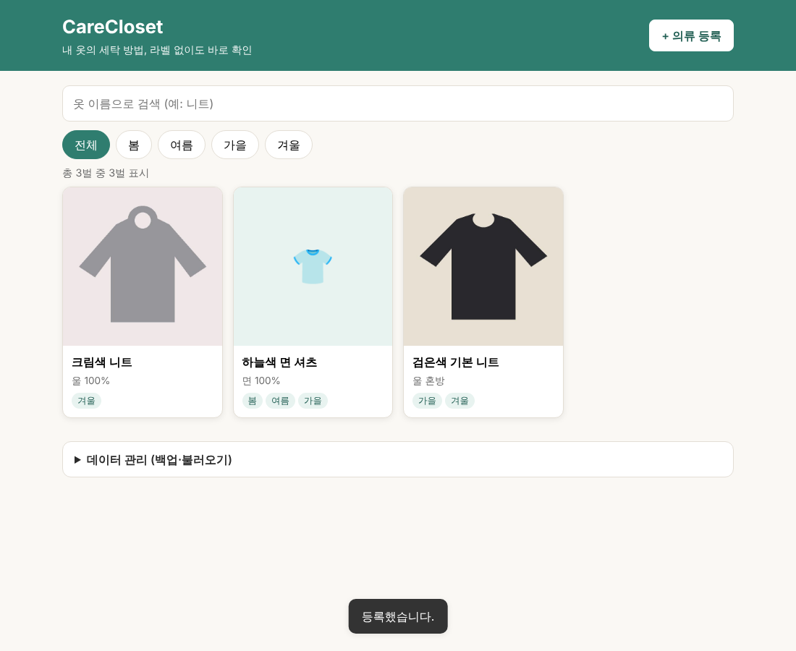
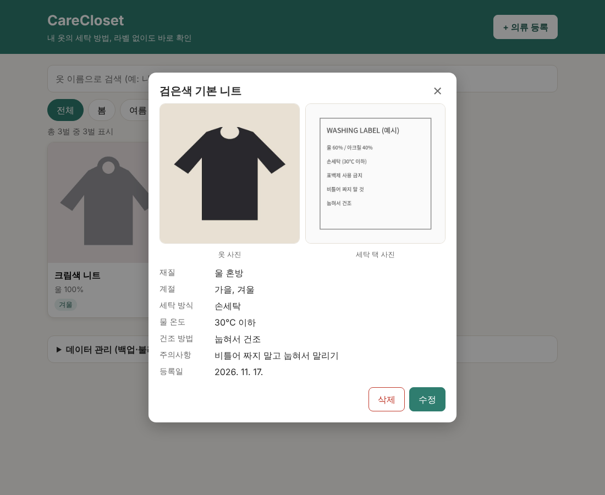
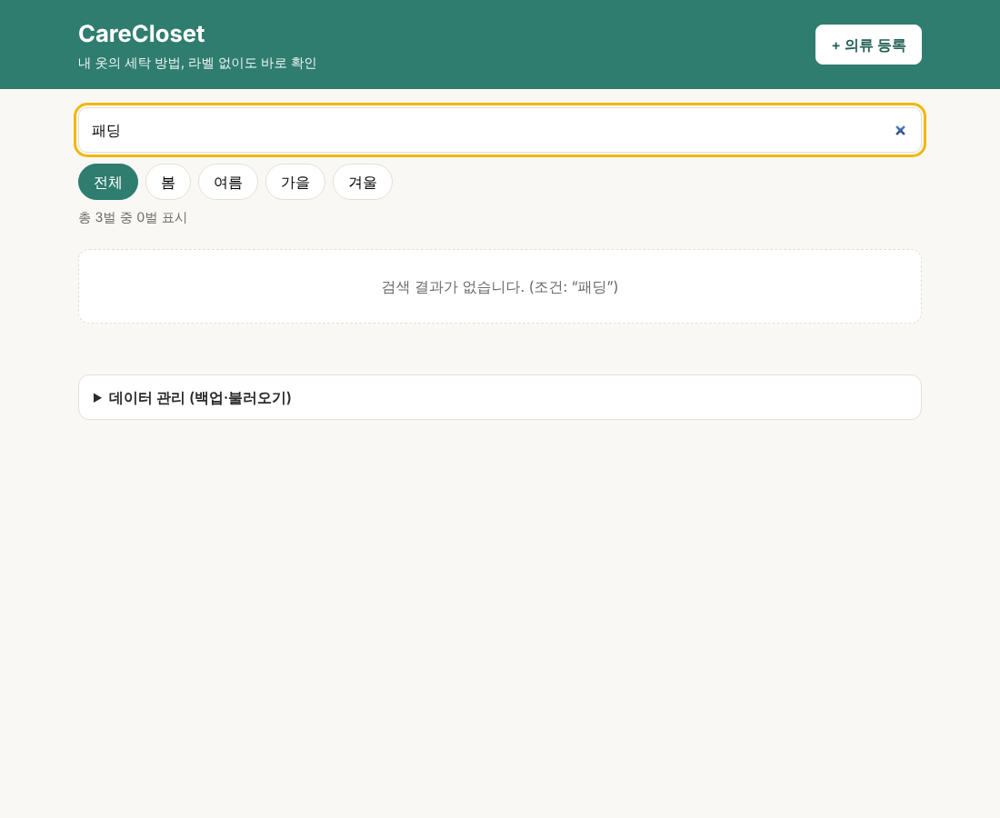
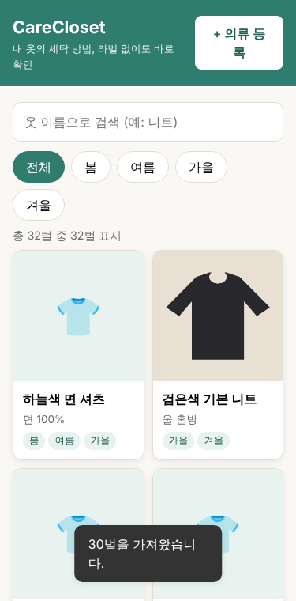

# CareCloset (가칭) - 개인 의류 세탁 정보 관리 웹서비스

> 세탁 라벨을 떼어 낸 옷도, 옷마다 다른 세탁 방법도 **옷별로 기록해 두고 필요할 때 바로 찾아보는** 웹서비스입니다.
> (과목: VSCode + GitHub Copilot 활용 실무 프로그래밍 입문 / 기말 캡스톤 프로젝트 / 202314029 김시은)

- 실행 페이지: https://kimsieun99.github.io/CareCloset/
- 저장소: https://github.com/kimsieun99/CareCloset

## 1. 프로젝트 소개

### 1.1 해결하려는 문제

- 세탁 라벨이 불편해 제거하면 이후 세탁·건조 방법을 확인하기 어렵다.
- 옷마다 재질과 관리 방법이 달라 여러 벌의 세탁 정보를 기억하기 어렵다.
- 사진과 메모가 흩어져 있으면 필요한 옷의 정보를 찾는 데 시간이 걸린다.

### 1.2 기능

옷 사진, 재질, 계절 태그, 세탁 방식·물 온도·건조 방법·주의사항을 **하나의 의류 기록**으로 저장합니다.
옷 이름 검색과 계절 필터로 원하는 옷의 세탁 정보를 빠르게 찾을 수 있습니다.
회원가입·서버 없이 **브라우저(IndexedDB)에 저장**하므로 사이트를 열기만 하면 바로 사용할 수 있습니다.

| 기능 | 설명 |
| --- | --- |
| 의류 등록 (FR-01) | 이름(필수), 재질, 계절 태그(복수 선택), 옷 사진(선택) |
| 세탁 정보 기록 (FR-02) | 세탁 방식, 물 온도, 건조 방법, 주의사항, 세탁 택 사진 보관 |
| 의류 조회 (FR-03) | 목록에서 선택하면 사진과 세탁 정보를 한 화면에서 확인 |
| 이름 검색 (FR-04) | 이름 일부로 검색 (앞뒤 공백·영문 대소문자 무시) |
| 계절 필터 (FR-05) | 봄/여름/가을/겨울 선택, 검색어와 함께 적용 가능 |
| 수정·삭제 (FR-06) | 등록한 의류 정보 수정(id·등록일 유지), 삭제(확인창 표시) |
| 결과 없음 안내 (FR-07) | 조건에 맞는 의류가 없으면 안내 문구 표시 |
| 백업 (추가) | JSON 내보내기/가져오기 |

## 2. 설치법

설치할 것이 없습니다. 두 가지 방법 중 편한 쪽으로 실행하세요.

1. **웹에서 바로 실행 (권장, 모바일 가능):** https://kimsieun99.github.io/CareCloset/ 접속
2. **내 컴퓨터에서 실행:** 저장소를 내려받아 압축을 풀고 `index.html`을 **더블클릭**해서 브라우저(Chrome, Edge, Whale, Safari 최신 버전)에서 엽니다.

```
CareCloset/
├─ index.html              화면 구조
├─ css/style.css           디자인(반응형)
├─ js/clothes.js           핵심 로직(검증·생성·검색·필터·가져오기) - 순수 함수, 테스트 대상
├─ js/storage.js           IndexedDB 저장소
├─ js/image.js             이미지 검증·리사이즈
├─ js/app.js               화면 동작(이벤트·렌더링)
├─ tests/                  테스트 코드 (clothes.test.js, filter.test.js, e2e/ui.e2e.js)
├─ tools/generate_sample_data.py   샘플 데이터 생성기
├─ sample/sample_clothes.json      샘플 30벌
├─ docs/refactoring/       리팩토링 전 코드, docs/screenshots/ 실행 화면
└─ test-results/           테스트 실행 로그
```

## 3. 사용법

1. 우측 상단 **`+ 의류 등록`** → 옷 이름(필수)과 나머지 정보를 입력하고 **저장**합니다.
2. 목록의 옷을 누르면 사진과 세탁 방법이 한 화면에 나옵니다. 여기서 **수정/삭제**할 수 있습니다.
3. 상단 검색창에 이름 일부(예: `니트`)를 입력하거나 `봄/여름/가을/겨울` 버튼을 눌러 거릅니다. 둘을 함께 쓸 수 있습니다.
4. 시연용 데이터가 필요하면 화면 아래 **`데이터 관리` → `가져오기`** 에서 `sample/sample_clothes.json`을 선택합니다.

> 데이터는 사용 중인 브라우저에만 저장됩니다. 브라우저 데이터 삭제나 기기 변경에 대비해 **내보내기**로 백업하세요.

## 4. 실행 환경과 필요한 패키지

| 용도 | 환경 | 필요한 패키지 |
| --- | --- | --- |
| 앱 실행 | 최신 웹 브라우저 (IndexedDB, `<dialog>` 지원) | 없음 |
| 단위 테스트 | **Node.js 18 이상** (개발 환경: v22) | 없음 (Node 내장 테스트 러너 `node:test` 사용) |
| 샘플 데이터 생성(선택) | **Python 3.8 이상** (개발 환경: 3.12) | 없음 (`requirements.txt` 참고, 표준 라이브러리만 사용) |
| 브라우저 통합 테스트(선택) | Node.js 18+ | `playwright` (`npm install --no-save playwright` 후 `npx playwright install chromium`) |

## 5. 테스트 실행 방법

```bash
npm test                  # 단위 테스트 42개 실행 (프로젝트 폴더에서)
npm run test:log          # 위와 같고, 결과를 test-results/latest.txt 에 저장
node --test --test-reporter=spec   # npm 없이 실행하는 방법
```

선택: 실제 브라우저로 등록→검색→수정→삭제 흐름 18개를 점검하는 통합 테스트
```bash
node tests/e2e/ui.e2e.js
```

테스트 결과 로그: `test-results/latest.txt`(단위), `test-results/e2e-log.txt`(통합), `test-results/before_refactoring.txt`(리팩토링 전).
샘플 데이터를 다시 만들려면 `python tools/generate_sample_data.py --count 30`.

### 5.1 테스트 구성

| 구분 | 개수 | 내용 |
| --- | --- | --- |
| 단위 테스트 | 42개 | 정상·예외·경계·성능. 예외 상황(빈 이름, 공백만 입력, 이름 41자, PDF·5MB 초과 이미지, `null`/`undefined` 목록, 잘못된 JSON 가져오기 등) 포함 |
| 브라우저 통합 테스트 | 18개 | 등록→검색→필터→수정→삭제, 중복 저장 요청 방지, 새로고침 후 데이터 유지, 모바일(375px), HTML 입력 보안, 콘솔 오류 0건 |

Copilot에게 "현재 테스트에서 빠진 경우"를 찾게 한 뒤, 의미 있는 경계 테스트 5개를 추가했습니다.
(텍스트 길이 허용 경계, 정확히 5MB 이미지 허용, 수정 시 계절 중복 제거·정렬, 정렬 시 원본 배열 보존, 내보내기 데이터 형식)

리팩토링 전 코드에 같은 필터 테스트를 돌려 보려면 (현재 필터 테스트 15개 중 리팩토링 전 코드에서 8개 실패 → 리팩토링 필요성의 근거):

```bash
# macOS / Linux
TEST_BEFORE=1 node --test --test-reporter=spec tests/filter.test.js
# Windows PowerShell
$env:TEST_BEFORE=1; node --test --test-reporter=spec tests/filter.test.js
```

### 5.2 비기능 요구사항 검증

| ID | 요구사항 | 검증 방법 | 결과 |
| --- | --- | --- | --- |
| NFR-01 | 100개 이하에서 검색·필터 1초 이내 | 단위: 100개×100회 반복 측정(1회 평균 약 0.0553ms) / 통합: 샘플 30벌에서 화면 반영 시간 측정 | 충족 |
| NFR-02 | 필수 입력 표시, 저장 후 목록에서 확인 | 등록 폼 "*필수" 표시, 등록 후 목록 반영 확인 | 충족 |
| NFR-03 | 빈 이름·잘못된 이미지에 안내, 비정상 종료 없음 | 예외 테스트 + 통합 테스트(폼 유지, 콘솔 오류 0건) | 충족 |
| NFR-04 | 새로고침 후에도 데이터 유지 | 등록 후 새로고침하여 유지 확인 | 충족 |
| NFR-05 | PC·모바일에서 주요 기능 사용 | 375px 폭에서 가로 스크롤 없음, 검색·등록·상세 동작 확인 | 충족 |

### 5.3 안정성을 위한 처리

- **입력 검증:** 빈 이름, 이름 길이, 허용되지 않은 계절 값, 이미지 형식·용량을 저장 전에 검사하고 필드별 오류 메시지를 표시합니다.
- **저장 실패 대비:** 저장소 오류(용량 부족 등)는 `try/catch`로 잡아 안내 메시지를 보여 주고 화면은 유지합니다.
- **보안:** 사용자 입력은 `textContent`로만 출력합니다. 이름에 ``를 입력해도 실행되지 않고 글자로 표시됨을 통합 테스트로 확인했습니다.
- **중복 저장 방지:** 저장 중에는 저장 버튼을 비활성화합니다.

## 6. MVP 체크리스트 (중간고사 계획서 기준)

| 구분 | 기능 | 상태 | 비고 |
| --- | --- | --- | --- |
| MVP 1 | 의류 사진 및 기본 정보 등록 (FR-01) | ✅ 완성 | 사진 없이도 등록 가능(기본 이미지 표시). 단위 + 브라우저 통합 테스트로 확인 |
| MVP 2 | 의류별 세탁 정보 저장 및 조회 (FR-02, FR-03) | ✅ 완성 | 세탁 택 사진 보관 포함, 상세 화면에서 한 번에 조회. 글자 자동 인식(OCR)은 계획대로 제외 |
| MVP 3 | 의류 이름 검색 (FR-04) | ✅ 완성 | 이름 일부·공백·대소문자 검색 |
| MVP 4 | 계절별 필터링 및 검색 결과 안내 (FR-05, FR-07) | ✅ 완성 | 여러 계절 태그, 검색어+계절 동시 적용, 결과 없음 안내 |
| 추가 | 수정 및 삭제 (FR-06) | ✅ 완성 | 추가 기능이었으나 구현. 수정 시 id·등록일 유지, 삭제 전 확인창 |
| 비기능 | NFR-01 성능 / 02 사용성 / 03 오류 처리 / 04 데이터 유지 / 05 반응형 | ✅ 충족 | 근거: 5.2절 |

미완성 항목: **없음**. 계획서가 범위에서 제외한 회원가입·로그인, 세탁 기호 자동 인식(OCR), 외부 AI 연동은 계획대로 구현하지 않았습니다.

## 7. 계획 변경 사항

| 중간고사 계획 | 실제 구현 | 이유 |
| --- | --- | --- |
| LocalStorage 또는 IndexedDB 중 선택 | **IndexedDB 확정** | LocalStorage는 약 5MB 제한이라 사진(옷+택)을 100벌 가까이 저장하기 어렵다 |
| 사진 저장 방식 구현 단계에서 확정 | **긴 변 800px JPEG로 리사이즈 후 data URL 저장**, 원본은 5MB 제한 | 저장 용량 절감 |
| Python은 "필요할 경우" 활용 | **샘플 데이터 생성기로 활용** | 100벌 성능 점검·시연 데이터를 반복 생성하기 위해 |
| 서버·DB 연동은 향후 확장 | 변경 없음. 대신 **JSON 내보내기/가져오기 추가** | 계획서 5.3의 한계(브라우저 데이터 삭제·기기 간 이동)를 서버 없이 보완 |
| 테스트 도구 미정 | **Node 내장 테스트 러너(`node:test`)** | 별도 설치 없이 실행 가능해 README만으로 재현 가능 |
| 앱 실행 방식 미정 | **GitHub Pages 웹 페이지로 배포** (로컬 `index.html` 더블클릭 실행도 가능) | 모바일에서도 바로 구동하기 위해. 로컬 실행을 위해 ES 모듈 대신 일반 `<script>`+UMD 방식 사용(`file://`에서 ES 모듈 차단) |
| 수정·삭제는 "추가" 기능 | **구현 완료** | 핵심 기능이 안정된 뒤 일정 내 구현 |

## 8. 코드 구조와 품질

화면, 저장소, 핵심 규칙을 파일 단위로 분리했습니다. 핵심 규칙(검증·생성·검색·필터)은 DOM이나 DB를 쓰지 않는 순수 함수로만 구성해, 브라우저와 Node.js 테스트에서 같은 코드를 그대로 사용합니다.

| 파일 | 역할 | 특징 |
| --- | --- | --- |
| `js/clothes.js` | 검증, 생성/수정, 검색·필터, 안내 문구, 가져오기 | 순수 함수, UMD로 브라우저/Node 공용, 단위 테스트 대상 |
| `js/storage.js` | IndexedDB 저장·조회·삭제 | Promise 기반, 트랜잭션 단위로 처리 |
| `js/image.js` | 이미지 형식 검증, 800px JPEG 리사이즈 | 투명 PNG는 흰 배경으로 변환 |
| `js/app.js` | 이벤트 처리와 화면 그리기 | 사용자 입력은 `textContent`로만 출력 |

적용한 원칙:
- **한 함수는 한 가지 일만:** `matchesQuery`, `matchesSeason`, `validateTextLength`처럼 조건을 이름 있는 함수로 분리
- **매직 값 제거:** 계절·세탁 방식·글자 수 제한·이미지 용량을 상수(`SEASONS`, `LIMITS`, `MAX_IMAGE_BYTES`)로 한 곳에서 관리
- **기본값과 방어 코드:** 목록이 `null`이거나 `seasons`가 없는 데이터가 와도 예외 없이 처리
- **원본 불변:** `updateClothing`은 기존 객체를 바꾸지 않고 새 객체를 반환하며 id·등록일 유지
- **접근성:** 라벨 연결, `aria-live` 안내, 오류 메시지 `role="alert"`, 키보드 포커스 표시

## 9. 개발 과정 (Copilot 활용)

VSCode의 GitHub Copilot Chat을 기획·설계, 핵심 로직, 화면·저장소, 테스트, 코드 리뷰, 리팩토링, 문서화의 전 단계에 활용했습니다.
프롬프트로 구현이나 분석을 요청하고, 결과를 검토해 채택하거나 수정을 요청한 뒤 테스트로 확인하는 방식으로 진행했습니다. 단계별 상세 기록(프롬프트·채택·수정 사항)은 기말보고서 7장에 있습니다.

### 9.1 Copilot Chat 활용 사례

| 단계 | 요청한 내용 | 채택·반영한 결과 |
| --- | --- | --- |
| 기획·설계 | 기획서의 요구사항·MVP 정리, 의류 데이터 구조와 검증 규칙, 저장 방식 비교(LocalStorage vs IndexedDB), 파일 구조 생성 | 요구사항·MVP 우선순위와 일정 초안, 필드·길이 제한 표, **IndexedDB + UMD/일반 `<script>` 구조(실제 채택)**, 역할 주석을 단 빈 골격 |
| 핵심 로직 | `validateClothing`, `createClothing`/`updateClothing`, `filterClothes`, 이미지 변환 | 상수 분리·한국어 오류 메시지·`{ valid, errors }` 반환, ID·등록일·이름 공백 제거·계절 정렬·불변 수정, 이름 검색+계절 필터, 800px JPEG 변환과 형식·5MB 제한(투명 PNG는 흰 배경, GIF는 첫 프레임) |
| 화면·저장소 | 목록·등록·상세 dialog·반응형 화면, IndexedDB 저장소, 앱 동작 | 입력칸별 오류 영역, Promise 기반 `getAll`/`save`/`saveMany`/`remove`와 한국어 `StorageError`, 등록·조회·검색·필터·수정·삭제 (물 온도 "직접 입력" 전환은 별도 구현) |
| 테스트 | 정상·예외 테스트, 빠진 경우 제안, 샘플 데이터 생성기와 100개 성능 테스트 | `node:test` + `assert/strict`, 한국어 테스트 이름과 FR 번호, 경계 테스트 5개 추가(총 39개), Python 생성기, 1초 성능 테스트 |
| 코드 리뷰 | `clothes.js`·`app.js`의 버그 가능성, 중복, 가독성, 보안 리뷰 | 우선순위별 지적 사항 정리 (이 단계에서는 코드 수정 없이 리뷰만 요청) |
| 리팩토링 | `filterClothes` 분리, `app.js`의 긴 함수·반복 DOM 코드 정리 | 작은 함수로 분리, 동작과 공개 함수 시그니처 유지 |
| 문서화 | README 작성 | 필수 섹션, 프로젝트 구조, 실행 명령, 수동 확인 항목 |

**Copilot의 제안을 그대로 쓰지 않고 판단한 부분**
- **저장 방식:** 사진을 함께 저장하려면 LocalStorage의 용량 제한(약 5MB)이 부담이 되어 IndexedDB를 채택했습니다. (7장 참고)
- **테스트 범위:** "빠진 경우" 제안 중 경계값·정규화·원본 보존·내보내기 형식 5개는 채택하고, 극단적이거나 구현 의미가 없는 항목은 제외했습니다.
- **테스트 이름:** 처음 영어 중심으로 작성된 테스트 이름을 한국어와 기능 번호(FR) 형식으로 다시 작성했습니다.
- **리팩토링:** 기존 동작을 잘못 바꿀 수 있는 추정 조건은 제외하고, 실제 테스트로 검증된 예외 처리만 사용했습니다.

### 9.2 디버깅 사례

| 문제 | 원인 | 해결 |
| --- | --- | --- |
| 폼 제출 메서드 오타 | `app.js` 초기 코드가 존재하지 않는 `event.preventEventDefault()`를 호출 | 올바른 이름 `preventDefault()`로 수정 |
| DOM 조회 메서드 오타 | `document.getElement("searchResultMessage")`로 잘못 작성 | `getElementById("searchResultMessage")`로 수정 |
| 문자 인코딩 손상 | 리팩토링 중 `app.js` 주석에 깨진 문자 발생 | 한국어 역할 주석과 정상 코드로 파일을 다시 작성 |

위 세 가지는 Copilot이 만든 코드에서 나온 오류이며, Copilot의 결과를 그대로 신뢰하지 않고 구문 검사(`node --check js/app.js`)와 테스트로 확인했습니다.

### 9.3 코드 리뷰와 리팩토링 사례

- **코드 리뷰:** `clothes.js`와 `app.js`를 버그 가능성, 중복, 가독성, 보안 관점에서 리뷰하게 했습니다. 지적된 항목은 저장 로딩 경쟁, 중복 제출, 수정 시 이전 파일 잔존, 필드 검증, 이미지 출처, 날짜 정렬, 중복 코드입니다. 리뷰 단계에서는 코드를 고치지 않고 지적 사항 정리만 요청했습니다.
- **`filterClothes` 리팩토링 (FR-04, FR-05):** 중첩 `if`와 중복 코드를 `normalizeFilterOptions`, `matchesQuery`, `matchesSeason`, `matchesAllFilters` 등 작은 함수로 나누고 잘못된 입력 처리를 적용했습니다. 동작과 공개 함수 시그니처는 유지했고 전체 테스트 통과를 확인했습니다.

  | 항목 | 리팩토링 전 | 리팩토링 후 |
  | --- | --- | --- |
  | 함수 구조 | 검색어와 계절을 하나의 반복문 안에서 중첩 처리 | 검색어·계절·전체 조건 판정을 각각 함수로 분리 |
  | 중첩 조건 | `if`가 3단계 이상 중첩 | 중첩 `if` 제거 |
  | 중복 코드 | 계절 필터 코드를 여러 곳에서 반복 | `matchesSeason()` 한 곳에서 처리 |
  | 검색어 공백·대소문자 | 앞뒤 공백 제거 안 함, 대소문자 구분 | 앞뒤 공백 제거, 대소문자 무시 |

  전/후 코드 비교는 기말보고서 6장과 `docs/refactoring/filter_before.js`를 참고하세요.
- **`app.js` 리팩토링:** `openForm`·`handleSubmit` 등 긴 함수를 폼 초기화, 필드 채우기, 입력값 검증, 데이터 저장, 화면 반영 함수로 나누고 요소 조회·DOM 생성 도우미, 카드·상세 화면 동작, 물 온도 직접 입력, 사진 처리, 저장 함수로 역할을 정리했습니다. 화면 흐름은 바꾸지 않았고, 구문 검사와 전체 단위 테스트로 정상 동작을 확인했습니다.

## 10. 실행 화면

| 목록 | 상세 | 검색 결과 없음 | 모바일 |
| --- | --- | --- | --- |
|  |  |  |  |

## 11. 한계와 향후 확장
- 데이터는 브라우저별로 저장되어 기기 간 자동 동기화가 되지 않습니다. (내보내기/가져오기로 수동 이동)
- 세탁 택 사진의 글자 자동 인식(OCR), 세탁 이력·마지막 세탁일 기록, 계정·서버 연동은 향후 확장 과제입니다.
